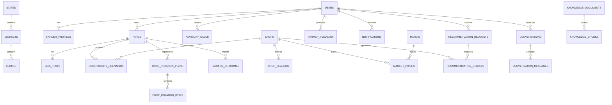

# KisanMitra — AI-Powered Smart Agriculture & Decision Intelligence Platform
> *"Know Your Land. Grow Smarter. Earn Better."*

---

## 🌾 1. Overview & Vision

**KisanMitra** is a comprehensive, production-quality agricultural decision-support platform designed for Indian farmers. Developed with an initial pilot focus on the mountainous and valley agro-climatic zones of **Uttarakhand, India**, KisanMitra features a modular, state-agnostic software architecture that scales seamlessly across all Indian states.

### Core Value Propositions
- **What to Cultivate:** Tri-Model Hybrid Ensemble (Fuzzy Logic + Bayesian Network + Decision Tree constraints) providing Explainable AI (XAI) crop suitability scoring.
- **When & How to Farm:** Agronomic sowing, irrigation, and harvesting calendar customized for terrace mid-hills, high hills, and tarai plains.
- **Pest & Disease Advisory:** 100% text-based diagnostic intelligence matching farmer-reported symptoms and microclimatic conditions with verified organic IPM protocols (ICAR-VPKAS Almora & GBPUAT Pantnagar). *Strictly no fragile computer vision / image uploads.*
- **Market & Mandi Intelligence:** Real-time price tracking, arrival volumes, modal price trends, and multi-mandi arbitrage comparisons (Haldwani, Kashipur, Dehradun Niranjanpur, Haridwar, Kotdwar).
- **Cultivation Economics:** Interactive profitability projections, itemized cost breakdowns (seed, fertilizer, labor, machinery), benefit-cost ratios (BCR), and breakeven yield/price thresholds.
- **RAG Knowledge Assistant:** Retrieval-Augmented Generation referencing official packages of practices and university extension bulletins.

---

## 🛠️ 2. Technology Stack

### Frontend Architecture
- **Framework:** React 19 + TypeScript + Vite 6
- **Styling & Design System:** Tailwind CSS v4, custom agricultural palette (`#174B35` Forest Green, `#3D8054` Agronomic Green, `#E8AD45` Warm Saffron)
- **Icons & Micro-interactions:** Lucide React, Framer Motion
- **Visualizations:** Recharts (responsive yield, price, and radar charts)
- **Routing & State:** React Router DOM v7, contextual React state with local caching and typed API services

### Backend & Database Architecture
- **Runtime & Web Framework:** Python 3.11+, FastAPI (high-performance asynchronous ASGI)
- **Data Validation & Settings:** Pydantic v2 & Pydantic-Settings
- **ORM & Database Layer:** SQLAlchemy 2.x with cross-dialect support (PostgreSQL 16 + PostGIS 3.4 for production; SQLite standalone fallback for local zero-dependency testing)
- **Database Migrations:** Alembic (version-controlled autogenerated schemas)
- **Authentication & Security:** Argon2id password hashing, RFC 7519 signed JSON Web Tokens (JWT) with bearer authorization and IDOR protection
- **Testing & Verification:** Pytest, HTTPX TestClient

---

## 📊 3. Database Architecture & ER Diagram



---

## 📡 4. REST API Endpoint Catalog (`/api/v1`)

| Module | Method | Path | Description |
|---|---|---|---|
| **Auth** | `POST` | `/api/v1/auth/register` | Register new farmer account |
| **Auth** | `POST` | `/api/v1/auth/login` | Login with mobile number & Argon2id hash |
| **Auth** | `GET` | `/api/v1/auth/me` | Fetch authenticated user & profile |
| **Farms** | `GET` | `/api/v1/farms/` | List farmer's registered plots (IDOR safe) |
| **Farms** | `POST` | `/api/v1/farms/` | Register new farm with area, soil & irrigation |
| **Soil** | `POST` | `/api/v1/soil/` | Record soil test (pH, N, P, K, Organic Carbon) |
| **Crops** | `GET` | `/api/v1/crops/` | Catalog of crops with agronomic thresholds |
| **Recommendations** | `POST` | `/api/v1/recommendations/` | Tri-Model Ensemble recommendation engine |
| **Regions** | `GET` | `/api/v1/regions/districts` | 13 Uttarakhand districts & agro-climatic zones |
| **Weather** | `GET` | `/api/v1/weather/?district=Almora` | 7-day agro-meteorological forecast & IMD alerts |
| **Market** | `GET` | `/api/v1/market/prices` | Live mandi arrival prices & volume trends |
| **Market** | `GET` | `/api/v1/market/comparison` | Cross-mandi price arbitrage analysis |
| **Economics** | `POST` | `/api/v1/economics/calculate` | Profitability, BCR, breakeven yield & price |
| **Advisory** | `POST` | `/api/v1/advisory/cases` | Text-based pest/disease inquiry & organic IPM |
| **Assistant** | `POST` | `/api/v1/assistant/chat` | RAG chat referencing verified research bulletins |
| **Rotation** | `POST` | `/api/v1/crop-rotation/` | Generate 4-season conservation rotation plan |
| **Feedback** | `POST` | `/api/v1/feedback/outcomes` | Record harvest outcome to validate AI accuracy |
| **Analytics** | `GET` | `/api/v1/analytics/farmer-summary` | High-level decision intelligence KPI metrics |

---

## 🚀 5. Getting Started & Local Development

### Prerequisites
- Node.js 18+ & npm
- Python 3.11+
- *(Optional)* Docker Desktop (for PostgreSQL/PostGIS)

### Backend Setup
```bash
# 1. Navigate to backend directory
cd backend

# 2. Install Python dependencies
python -m pip install -r requirements.txt

# 3. Seed initial database (13 Uttarakhand districts, crops, mandis, demo farmer)
python -c "import sys; sys.path.insert(0, '.'); from app.db.session import SessionLocal; from app.db.init_db import init_db; from scripts.seed_data import run_seed; db = SessionLocal(); init_db(db); run_seed(db); db.close()"

# 4. Start FastAPI server with live reload
uvicorn app.main:app --host 0.0.0.0 --port 8000 --reload
```
Interactive Swagger API documentation will be available at: **`http://localhost:8000/api/v1/docs`**

### Running Backend Automated Tests
```bash
python -m pytest backend/tests/test_api.py -v
```

### Frontend Setup
```bash
# 1. In project root, install node dependencies
npm install

# 2. Launch Vite development server
npm run dev
```
Open **`http://localhost:5173/`** in your browser.

### Default Demo Credentials
- **Mobile Number:** `9876543210`
- **Password:** `FarmerPassword123!`
- **Name:** Surendra Singh Negi (Almora, Uttarakhand)

---

## 🐳 6. Docker Compose Deployment

To run the complete full-stack environment with PostgreSQL 16 + PostGIS:
```bash
docker compose up -d --build
```
This spins up:
- `kisanmitra-db`: PostgreSQL 16 with PostGIS extension on port 5432
- `kisanmitra-backend`: FastAPI application on port 8000

---

## 🛡️ 7. Agronomic Integrity & Safety Standards

1. **No Fabricated Machine Learning Weights:** All mock and future ML interfaces are explicitly typed with `is_demo=True` and clear decoupling interfaces for production model weights.
2. **Text-Based Advisory Focus:** Avoids unreliable computer vision image recognition in field conditions. Instead, farmers enter observed foliar symptoms, plant growth stages, and terrace moisture levels for high-precision diagnostic matching.
3. **Official Disclaimers:** Every advisory case and recommendation output includes explicit disclaimers directing farmers to verify chemical interventions with their local Block Agriculture Officer (BAO) or Krishi Vigyan Kendra (KVK).
