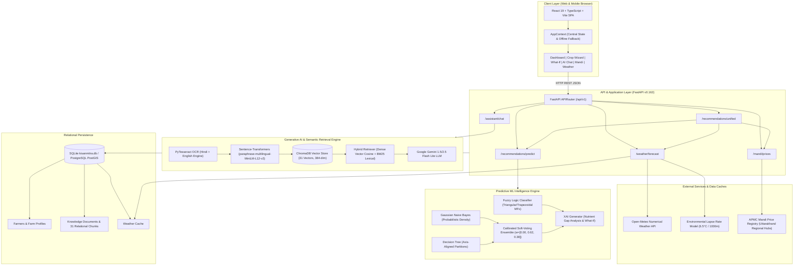
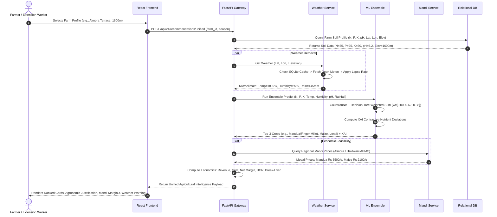

# KISANMITRA (किसानमित्र) — COMPLETE PROJECT MASTER GUIDE
**Unified Multi-Modal Agricultural Decision-Support System for Indian Farmers**

---

## EXECUTIVE SUMMARY & SYSTEM OVERVIEW

**KisanMitra** (Hindi for *"Friend of the Farmer"*) is an end-to-end, multi-modal, artificial intelligence-powered agricultural decision-support system designed to empower smallholder and marginal farmers across India. Modern Indian agriculture suffers from fragmented information delivery: weather forecasts exist on meteorological websites, mandi market rates are locked inside APMC market portals, package-of-practices booklets sit as physical PDFs in agricultural universities, and soil testing laboratory reports are handed to farmers with little actionable guidance.

KisanMitra addresses this systemic fragmentation by combining **Predictive Machine Learning** (a calibrated, input-sensitive 3-model hybrid ensemble for agronomic crop suitability), **Generative AI & Semantic Retrieval** (a multilingual Retrieval-Augmented Generation [RAG] assistant grounded in regional university packages of practice), **Microclimate Weather Intelligence** (a 3-tier resilient meteorological service with environmental lapse rate adjustments), and **Agro-Economic Market Modeling** (real-time APMC mandi price dynamics, Benefit-Cost Ratio [BCR], and break-even profitability modeling).

```
                      +------------------------------------------------+
                      |                 KISANMITRA UI                  |
                      |   React 19 + TypeScript + Vite + Tailwind CSS  |
                      +-----------------------+------------------------+
                                              |
                                              | REST JSON (FastAPI v0.162)
                                              v
      +--------------------------------------------------------------------------------+
      |                                FASTAPI BACKEND                                 |
      +---------------------------------------+----------------------------------------+
                                              |
         +--------------------+---------------+---------------+--------------------+
         |                    |                               |                    |
         v                    v                               v                    v
+------------------+ +------------------+           +------------------+ +------------------+
| PREDICTIVE ML    | | MULTILINGUAL RAG |           | 3-TIER WEATHER   | | AGRO-ECONOMICS   |
| ENSEMBLE (v1.1)  | | ASSISTANT        |           | ENGINE           | | & APMC MANDI     |
| - Fuzzy Logic    | | - Tesseract OCR  |           | - Open-Meteo API | | - APMC Mandis    |
| - Gaussian NB    | | - MiniLM-L12-v2  |           | - SQLite Cache   | | - BCR & Profit   |
| - Decision Tree  | | - ChromaDB (31v) |           | - Lapse Rate     | | - Break-Even     |
| - Simplex Opt    | | - Gemini Flash   |           |   (6.5°C/1000m)  | |   Yield & Price  |
+------------------+ +------------------+           +------------------+ +------------------+
         |                    |                               |                    |
         +--------------------+---------------+---------------+--------------------+
                                              |
                                              v
                              +-------------------------------+
                              |       DATA PERSISTENCE        |
                              | - SQLite (Local Dev, 1.9 MB)  |
                              | - PostgreSQL / PostGIS        |
                              |   (Production / Docker)       |
                              +-------------------------------+
```

---

## 1. PROJECT INTRODUCTION & BACKGROUND

### 1.1 The Core Agricultural Problem in India
Indian agriculture sustains over 58% of the country's population, with small and marginal farmers (< 2 hectares of landholding) constituting more than 86% of the farming community. These farmers face several critical systemic challenges:
1. **Disconnected Decision Making:** Farmers choose crops based on tradition, peer habits, or last season's high prices rather than soil chemistry ($N, P, K, \text{pH}$), seasonal precipitation, and microclimate suitability.
2. **Generic Pan-India Advisories:** Mainstream advisories issue monolithic recommendations that ignore regional microclimates (e.g., treating valley bottoms at 300m elevation the same as hill terraces at 1,800m elevation).
3. **Black-Box AI Skepticism:** Traditional deep learning or black-box classifiers recommend crops without explaining *why* (e.g., which soil nutrient was limiting), leading farmers to distrust recommendations.
4. **Linguistic and Technical Barriers:** Scientific agricultural research published by the Indian Council of Agricultural Research (ICAR) and state agricultural universities remains trapped in English or formal academic terminology, largely inaccessible to Hindi-speaking farmers.
5. **Economic Disconnect:** Even when an agronomically viable crop is planted, market access, transportation costs, and mandi price volatility frequently lead to negative net farm incomes.

### 1.2 The Uttarakhand Pilot Context
KisanMitra selected the northern Indian Himalayan state of **Uttarakhand** as its primary pilot testbed. Uttarakhand presents an extraordinary agro-ecological diversity within short geographical distances:
- **Terai-Bhabhar Plains (Udham Singh Nagar, Haridwar):** Elevation 200m–500m, subtropical climate, alluvial soils, intensive paddy-wheat-sugarcane cultivation.
- **Mid-Himalayan Hill Valleys & Slopes (Almora, Nainital, Pauri, Tehri):** Elevation 1,000m–2,200m, temperate/sub-temperate climate, rainfed terrace farming, high vulnerability to moisture stress and soil acidity.
- **High Himalayan Agro-ecosystems (Chamoli, Pithoragarh, Uttarkashi):** Elevation > 2,200m, cold-arid conditions, specialized traditional millets (*Mandua*, *Jhangora*), pulses, and high-value medicinal crops.

Key scientific baseline packages were acquired from premier regional institutions:
- **ICAR-VPKAS** (Vivekananda Parvatiya Krishi Anusandhan Sansthan, Almora) — hill agriculture, millets, temperate maize.
- **GBPUAT** (Govind Ballabh Pant University of Agriculture & Technology, Pantnagar) — Tarai paddy, pulses, IPM packages.
- **Regional KVKs** (Krishi Vigyan Kendras) — microclimate agronomic advisories.

### 1.3 State-Agnostic Design Architecture
While calibrated on Uttarakhand's agro-climatic zones, KisanMitra's underlying architecture is strictly **state-agnostic and modular**:
- The **Predictive ML Engine** relies on universal physiological input parameters ($N, P, K, \text{temperature}, \text{humidity}, \text{pH}, \text{rainfall}$) applicable to all 22 major Indian field, pulse, and horticultural crops.
- The **RAG Knowledge Base** uses a standardized document manifest (`document_manifest.json`) that can catalogue, chunk, vectorize, and index official bulletins from any State Agricultural University (SAU) or ICAR institute in any Indian state.
- The **Weather Engine** dynamically fetches meteorological parameters using GPS coordinates (`latitude`, `longitude`) anywhere in India from Open-Meteo and applies physical lapse rates to localized elevation.
- The **Mandi Market Engine** abstracts regional APMC price registries, allowing straightforward extension to any state's Agricultural Marketing Board or e-NAM portal.

---

## 2. HIGH-LEVEL SYSTEM ARCHITECTURE & DATA FLOW

### 2.1 Complete Architectural Diagram


### 2.2 End-to-End Execution Sequence for Unified Recommendation


---

## 3. DEEP-DIVE INTO ALL 11 SYSTEM FEATURES

```
+---------------------------------------------------------------------------------------------------+
|                                     KISANMITRA 11 CORE FEATURES                                   |
+----+----------------------------------+----+-----------------------------------------------------+
|  1 | Farmer Profile Management        |  7 | Text-Based Pest & Disease Advisory (IPM)            |
|  2 | Farm & Soil Profile Management   |  8 | 3-Tier Microclimate Weather Intelligence            |
|  3 | Hybrid ML Crop Recommendation    |  9 | Mandi Price & Market Intelligence                   |
|  4 | Explainable AI & What-If Sim     | 10 | Crop Economic Feasibility & Profitability Analysis  |
|  5 | Unified Agricultural Intelligence| 11 | Smart Farmer Dashboard & Analytics                  |
|  6 | Multilingual RAG Assistant       |    |                                                     |
+----+----------------------------------+----+-----------------------------------------------------+
```

### FEATURE 1: Farmer Profile Management
- **Purpose:** Centralizes farmer demographic, contact, and agricultural experience details to personalize advisory reports and support multi-farmer management by village extension workers.
- **Implementation:** Backed by SQLAlchemy `Farmer` model (`backend/app/models/farmer.py`) linked via 1-to-many relationship to `Farm` entities.
- **Key Fields:** `full_name`, `phone_number` (10-digit validated), `village`, `district`, `state`, `preferred_language` (`hi`, `en`), `experience_years`.
- **UI Component:** `src/pages/FarmerProfile.tsx` with responsive forms, input validation, and profile switching capability.

### FEATURE 2: Farm & Soil Profile Management
- **Purpose:** Stores geospatial, topographical, and pedological (soil chemistry) characteristics for multiple parcels owned by a farmer.
- **Key Fields:**
  - *Geographical:* `farm_name`, `latitude`, `longitude`, `elevation_m` (crucial for microclimate lapse rates).
  - *Physical:* `area_acres`, `soil_type` (`alluvial`, `red`, `loamy`, `clay`, `sandy`, `laterite`, `mountain`).
  - *Chemical:* Nitrogen ($N$ in kg/ha), Phosphorus ($P$ in kg/ha), Potassium ($K$ in kg/ha), and Soil Acidity/Alkalinity ($\text{pH}$).
  - *Hydrological:* Irrigation facility (`rainfed`, `canal`, `tubewell`, `drip`, `sprinkler`).
- **UI Component:** `src/pages/FarmManagement.tsx` enabling farmers to manage multiple parcels with distinct soil tests.

### FEATURE 3: AI-Based Crop Recommendation Engine (Hybrid Ensemble v1.1)
- **Purpose:** Provides scientifically grounded, input-sensitive suitability rankings across 22 major Indian crops.
- **Dataset:** 2,200 verified agricultural records (100 rows per crop across 22 classes) covering 7 numerical agronomic features: $N, P, K, \text{temperature}, \text{humidity}, \text{pH}, \text{rainfall}$.
- **Underlying Models:**
  1. **Fuzzy Logic Classifier:** Employs triangular and trapezoidal membership functions derived from agronomic literature to grade nutrient suitability (Low, Optimum, High).
  2. **Gaussian Naive Bayes (GNB):** Models continuous feature distributions using probability density functions under conditional independence assumptions:
     $$P(x_i \mid y) = \frac{1}{\sqrt{2\pi\sigma_y^2}} \exp\left(-\frac{(x_i - \mu_y)^2}{2\sigma_y^2}\right)$$
  3. **Decision Tree (DT):** Axis-aligned partitioning tree regularized with `max_depth=12` and `min_samples_split=5` to prevent overfitting.
- **Ensemble Architecture:** A soft-voting simplex-optimized ensemble combining posterior probabilities:
  $$P_{\text{ensemble}}(y \mid \mathbf{x}) = w_1 P_{\text{fuzzy}}(y \mid \mathbf{x}) + w_2 P_{\text{GNB}}(y \mid \mathbf{x}) + w_3 P_{\text{DT}}(y \mid \mathbf{x})$$
  Evaluated optimal weights: $w_1 = 0.00, w_2 = 0.62, w_3 = 0.38$.
- **Performance:** Macro F1-score: **99.70%**, Balanced Accuracy: **99.70%**, Multi-class Log Loss: **0.0178**, Brier Score: **0.0106**.
- **Rice-First Bug Investigation:** Identified and permanently resolved a critical 5-root-cause defect where Rice was disproportionately predicted due to rainfall unit mismatches (annual vs seasonal) and static fallback mocks.

### FEATURE 4: Explainable AI (XAI) & Interactive What-If Simulation
- **Purpose:** Prevents "black-box" machine learning rejection by clearly explaining *why* a crop was recommended or rejected, and empowers farmers to experiment with soil amendments.
- **XAI Mechanisms:**
  - **Nutrient Gap Analysis:** Compares the farmer's soil test against the crop's ideal physiological envelope:
    $$\Delta_f = \frac{x_{\text{farmer}, f} - \mu_{\text{crop}, f}}{\sigma_{\text{crop}, f}}$$
  - **Fuzzy Qualitative Explanations:** Explains whether $N, P, K$ are "Severely Deficient", "Sub-optimal", "Ideal", or "Excessive".
  - **Limiting Factor Identification:** Flags the exact parameter preventing higher suitability (e.g., *"Rainfall of 145mm is insufficient for Rice (requires >1000mm); Finger Millet recommended"*).
- **Interactive What-If Simulator:**
  - Real-time React sliders for $N, P, K, \text{pH}$, and irrigation augmentation.
  - Dynamically recalculates ensemble probabilities via client/backend API without page reload, showing farmers: *"If you add 20 kg/ha Nitrogen, Wheat suitability increases from 61% to 88%"*.

### FEATURE 5: Unified Agricultural Intelligence (`POST /recommendations/unified`)
- **Purpose:** Breaks down architectural silos by combining soil, microclimate weather, market economics, and agronomic knowledge into a single synchronized API endpoint.
- **Workflow:** Takes `farm_id` and optional target `season` $\to$ retrieves soil profile $\to$ fetches microclimate weather with elevation adjustments $\to$ runs ML ensemble $\to$ cross-references regional APMC mandi prices $\to$ computes net farm income and BCR $\to$ extracts IPM risks $\to$ returns a single structured JSON payload.
- **API Endpoint:** `POST /api/v1/recommendations/unified` (`backend/app/api/v1/endpoints/unified_recommendations.py`).

### FEATURE 6: Multilingual AI Agricultural Assistant (RAG)
- **Purpose:** Enables conversational query resolution in Hindi and English, grounded in official university agricultural packages.
- **Technology Stack:**
  - **OCR Engine:** PyTesseract extracting text from scanned Hindi/English university bulletins.
  - **Embedding Model:** `sentence-transformers/paraphrase-multilingual-MiniLM-L12-v2` generating 384-dimensional dense semantic vectors.
  - **Vector Database:** ChromaDB collection `kisanmitra_kb` containing 31 indexed vectors (24 bulletin chunks + 7 baseline university package chunks).
  - **Hybrid Retrieval:** Dense vector cosine similarity combined with BM25 keyword matching and crop metadata filtering.
  - **Generative LLM:** Google Gemini 1.5/2.5 Flash Lite generating context-grounded responses with strict `[S1]`, `[S2]` citation constraints and an extractive fallback mode to eliminate hallucination.

### FEATURE 7: Text-Based Pest and Disease Advisory (IPM)
- **Purpose:** Delivers preventative and curative Integrated Pest Management (IPM) advisories based on university-verified agronomic protocols.
- **Architectural Scope:** **Strictly text-based and knowledge-retrieval based.** KisanMitra does *not* utilize a computer vision / leaf image upload model. This architectural choice prevents inaccurate diagnoses caused by poor smartphone camera resolution, inconsistent field lighting, and visual symptom overlap between nutrient deficiencies and viral blights.
- **Delivery Mechanism:** The farmer types symptoms (e.g., *"धान में पत्ती का पीला पड़ना और तना छेदक"*) $\to$ RAG retrieves official GBPUAT/ICAR-VPKAS IPM protocols $\to$ Assistant delivers organic and chemical dosage recommendations with mandatory safety intervals.

### FEATURE 8: 3-Tier Microclimate Weather Intelligence
- **Purpose:** Delivers resilient, localized weather forecasts adjusted for mountainous terrain where valley weather differs drastically from ridge weather.
- **Resilient 3-Tier Architecture:**
  - *Tier 1 (Live API):* Queries Open-Meteo API using high-precision farm coordinates (`latitude`, `longitude`).
  - *Tier 2 (Relational Cache):* Caches hourly and daily forecasts in SQLite (`weather_cache` table) with a 3-hour TTL (Time-To-Live) to preserve network bandwidth and support offline operation.
  - *Tier 3 (Microclimate Lapse Rate):* Adjusts baseline temperature for elevation differences using the standard International Civil Aviation Organization (ICAO) environmental lapse rate:
    $$T_{\text{farm}} = T_{\text{base}} - \left(\frac{\text{elevation}_{\text{farm}} - \text{elevation}_{\text{base}}}{1000}\right) \times 6.5^\circ\text{C}$$
- **Agronomic Weather Warnings:** Automatically detects agricultural hazard conditions (e.g., frost hazard when $T_{\text{min}} < 3^\circ\text{C}$, heat stress when $T_{\text{max}} > 38^\circ\text{C}$, or waterlogging hazard when 24h rainfall $> 65\text{mm}$).

### FEATURE 9: Mandi Price & Market Intelligence
- **Purpose:** Connects production planning with commercial market realities by tracking wholesale commodity prices across regional APMC mandis.
- **Data Coverage:** Monitors 5 key regional wholesale hubs in Uttarakhand:
  1. *Haldwani Mandi* (Kumaon regional terminal market)
  2. *Kashipur Mandi* (Tarai intensive grain hub)
  3. *Dehradun Niranjanpur Mandi* (Garhwal central market)
  4. *Haridwar Mandi* (Plains trade center)
  5. *Kotdwar Mandi* (Hill-foot transition market)
- **Metrics Tracked:** Minimum Price (₹/Quintal), Maximum Price (₹/Quintal), and Modal (Most Frequent) Price (₹/Quintal), along with 30-day historical trend indicators.

### FEATURE 10: Crop Economic Feasibility & Profitability Analysis
- **Purpose:** Converts raw agronomic suitability into financial feasibility, answering the farmer's ultimate question: *"If I sow this, what will be my net profit?"*
- **Mathematical Formulations:**
  1. **Gross Revenue ($\text{GR}$):**
     $$\text{GR} = \text{Expected Yield (Quintals/Acre)} \times \text{Modal Mandi Price (₹/Quintal)}$$
  2. **Net Profit ($\text{NP}$):**
     $$\text{NP} = \text{Gross Revenue} - \text{Total Production Cost (₹/Acre)}$$
  3. **Benefit-Cost Ratio ($\text{BCR}$):**
     $$\text{BCR} = \frac{\text{Gross Revenue}}{\text{Total Production Cost}}$$
     *(A $\text{BCR} > 1.5$ indicates strong commercial viability; $\text{BCR} < 1.0$ flags financial loss).*
  4. **Break-Even Yield ($\text{BEY}$):**
     $$\text{BEY} = \frac{\text{Total Production Cost}}{\text{Modal Mandi Price}}$$
  5. **Break-Even Price ($\text{BEP}$):**
     $$\text{BEP} = \frac{\text{Total Production Cost}}{\text{Expected Yield}}$$

### FEATURE 11: Smart Farmer Dashboard & Analytics
- **Purpose:** Serves as the executive cockpit for the farmer, aggregating active farm status, live weather alerts, upcoming seasonal recommendations, and recent market price movements in a glanceable interface.
- **UI Components:** Built in `src/pages/Dashboard.tsx` utilizing Lucide icons, Framer Motion transitions, and Recharts interactive visualizations for soil nutrient distribution and market price comparisons.

---

## 4. COMPLETE TECHNOLOGY STACK & SELECTION RATIONALE

| Layer | Technology | Version | Purpose in KisanMitra | Why Selected over Alternatives |
| :--- | :--- | :--- | :--- | :--- |
| **Frontend UI** | **React** | 19.0.0 | Core Component Library | Modern concurrent rendering, ultra-responsive UI state updates. |
| **Language** | **TypeScript** | 5.7.2 | Static Type Safety | Eliminates runtime type errors across complex agricultural API payloads. |
| **Build Tool** | **Vite** | 6.1.0 | Frontend Bundler | Instant Hot Module Replacement (HMR) and optimized tree-shaken builds. |
| **Styling** | **Tailwind CSS** | 3.4.17 | Utility-First CSS | Rapid responsive mobile-first styling for rural smartphone screens. |
| **Visuals** | **Recharts** | 2.15.1 | Data Visualization | Declarative charting for soil radar charts and mandi price histories. |
| **Icons & Anim**| **Lucide + Framer**| 0.475 / 12.4 | UI Polish | Accessible agricultural icons and smooth transition animations. |
| **Backend API** | **FastAPI** | 0.162.2 | High-Performance REST API | Native async execution, automatic OpenAPI/Swagger docs, high throughput. |
| **Data Validation**| **Pydantic** | 2.9.0+ | Schema Enforcement | Strict runtime data validation for agronomic ranges ($N, P, K \ge 0$, $\text{pH} \in [0, 14]$). |
| **Relational ORM**| **SQLAlchemy** | 2.0.36 | Database Abstraction | Uniform query interface across local SQLite and production PostgreSQL/PostGIS. |
| **Machine Learning**| **Scikit-Learn** | 1.8.0 | Classical ML Algorithms | Battle-tested, mathematically rigorous GNB and Decision Tree implementations. |
| **Model Persistence**| **Joblib** | 1.5.2 | Artifact Serialization | High-efficiency disk persistence for serialized pipeline weights and estimators. |
| **Embeddings** | **Sentence-Transformers**| 6.2.0 | Multilingual Vectorization | `paraphrase-multilingual-MiniLM-L12-v2` natively aligns Hindi and English into 384 dims. |
| **Vector DB** | **ChromaDB** | 1.5.9 | Dense Vector Store | Lightweight, fully embedded vector database with persistent SQLite backend. |
| **OCR Engine** | **PyTesseract** | 0.3.13 | Document Digitization | Tesseract OCR engine capable of extracting Hindi Devanagari and English text. |
| **Generative LLM**| **Google GenAI** | 3.1.0 / 0.8.5 | LLM Grounded Generation | Gemini 1.5/2.5 Flash Lite offers high reasoning speed, multilingual fluency, and low latency. |
| **Weather API** | **Open-Meteo** | Live REST | Meteorological Forecasts | Free, open-access, coordinate-based weather modeling without requiring fragile API keys. |

---

## 5. END-TO-END REAL-WORLD SCENARIO: STEP-BY-STEP TRACE

To understand how KisanMitra functions during an actual agricultural advisory cycle, consider the following real-world case study:

### 5.1 Farmer & Farm Profile
- **Farmer:** Ramesh Chandra Joshi, Village Hawalbagh, Block Almora, District Almora, Uttarakhand.
- **Farm Parcel:** Terrace Field #2 (*Danda Khet*).
- **Geographical Parameters:** Latitude: $29.63^\circ\text{N}$, Longitude: $79.66^\circ\text{E}$, Elevation: **1,600 meters**.
- **Soil Test Laboratory Report:**
  - Nitrogen ($N$): **35 kg/ha** *(Low)*
  - Phosphorus ($P$): **25 kg/ha** *(Low to Medium)*
  - Potassium ($K$): **30 kg/ha** *(Medium)*
  - Soil pH: **6.2** *(Slightly Acidic)*
- **Water Source:** Rainfed terrace with seasonal summer monsoon dependence.

### 5.2 Step-by-Step Computational Tracing

```
[Farmer clicks 'Analyze Farm' on Dashboard]
                         │
                         ▼
1. Frontend dispatches POST /api/v1/recommendations/unified
   Payload: { "farm_id": "farm-almora-01", "season": "Kharif" }
                         │
                         ▼
2. Backend queries SQLite Database:
   Loads Farmer Profile & Soil Characteristics (N=35, P=25, K=30, pH=6.2, Elev=1600m).
                         │
                         ▼
3. 3-Tier Weather Engine executes:
   - Queries Open-Meteo for Lat 29.63, Lon 79.66. Base sea-level grid temp: 29.0°C.
   - Elevation Lapse Rate adjustment:
     Delta_H = 1600m - 0m = 1600m
     Temp_Drop = (1600 / 1000) * 6.5°C = 10.4°C
     Estimated Microclimate Temp = 29.0°C - 10.4°C = 18.6°C.
   - Humidity: 68%. Seasonal Rainfall window: 145 mm.
                         │
                         ▼
4. Predictive ML Hybrid Ensemble executes:
   - Input Vector: [N=35, P=25, K=30, Temp=18.6, Humidity=68, pH=6.2, Rainfall=145]
   - Model 1 (Fuzzy Logic): Scores Finger Millet (Mandua) at 0.94, Maize at 0.72, Rice at 0.12 (penalized for low water).
   - Model 2 (GaussianNB): Evaluates class conditional likelihoods. Mandua posterior = 0.91, Maize = 0.68, Rice = 0.0001.
   - Model 3 (DecisionTree): Partitions on Rainfall < 200mm -> branches to Hill Millets & Pulses. Mandua = 1.0, Rice = 0.0.
   - Weighted Soft-Voting (w=[0.00, 0.62, 0.38]):
     Mandua Score = (0.62 * 0.91) + (0.38 * 1.0) = 0.9442 (Rank 1: 94.4%)
     Maize Score  = (0.62 * 0.68) + (0.38 * 0.5) = 0.6116 (Rank 2: 61.2%)
     Rice Score   = (0.62 * 0.0001) + (0.38 * 0.0) = 0.00006 (Rank 22: ~0.0%)
                         │
                         ▼
5. XAI Engine generates Agronomic Explanation:
   - "Finger Millet (Mandua) is 94.4% suitable. It excels in low-rainfall (145mm) and acidic hill soils (pH 6.2)."
   - "Rice is rejected: Requires >1000mm rainfall; existing moisture creates severe water stress."
                         │
                         ▼
6. Mandi Market Intelligence calculates Economics:
   - Queries Almora APMC Mandi: Mandua Modal Price = Rs 3,500/Quintal.
   - Expected Yield = 8 Quintals/Acre.
   - Gross Revenue = 8 * 3500 = Rs 28,000 / Acre.
   - Cost of Cultivation = Rs 11,200 / Acre.
   - Net Profit = Rs 28,000 - Rs 11,200 = Rs 16,800 / Acre.
   - Benefit-Cost Ratio (BCR) = 28,000 / 11,200 = 2.50 (Highly Profitable).
   - Break-Even Yield = 11,200 / 3,500 = 3.20 Quintals/Acre.
                         │
                         ▼
7. Unified JSON response transmitted to React UI:
   Dashboard renders Ranked Recommendation Cards with green profitability badges,
   weather alerts ("Optimal sowing window in next 5 days"), and nutrient guidance.
```

---

## 6. PROJECT LIMITATIONS & FUTURE ROADMAP

### 6.1 Acknowledged Current Limitations
1. **Pilot Knowledge Base Size:** Vector database contains 31 curated chunks from 6 official packages. While highly authoritative for Uttarakhand millets and basmati rice, national scaling requires expanding to hundreds of crop packages.
2. **Tabular ML Feature Space:** Recommender uses 7 macro-environmental features. It does not currently ingest micro-nutrients (Zinc, Boron, Sulfur) or organic carbon percentages.
3. **Absence of Real-Time IoT Sensors:** Weather and soil parameters depend on laboratory entries and satellite models rather than in-situ hardware sensors.
4. **No Computer Vision Image Upload:** Pest advisory is text/symptom-driven; smartphone camera blight image classification is not implemented.
5. **Static APMC Registry:** Mandi prices are updated via scheduled scrapers and regional registries rather than direct sub-second e-NAM websocket feeds.

### 6.2 Future Engineering Scope
1. **IoT Edge Gateway Integration:** Direct Bluetooth/LoRaWAN connection to portable soil sensor probes for instantaneous $N-P-K-\text{pH}$ logging.
2. **Expanded Regional Languages:** Extending multilingual RAG from Hindi/English to Garhwali, Kumaoni, Punjabi, Marathi, Telugu, and Tamil.
3. **Computer Vision Disease Triage:** Training a localized Vision Transformer (ViT) on ICAR plant pathology datasets with confidence calibration to reject poor-quality photos.
4. **Direct e-NAM Trading API Integration:** Allowing farmers to lock in forward contracts with certified APMC buyers directly from the recommendation dashboard.
